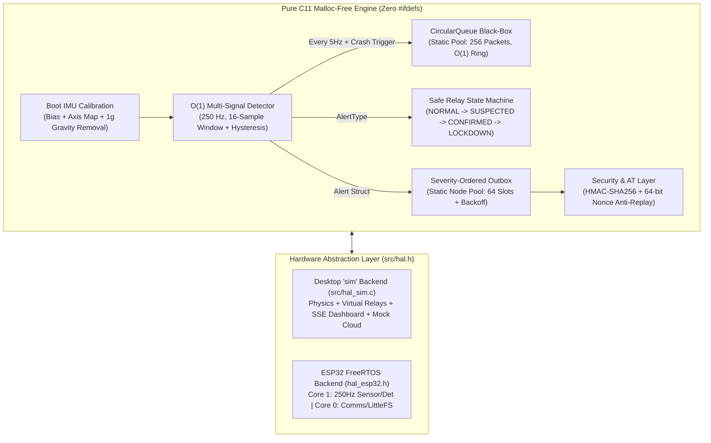
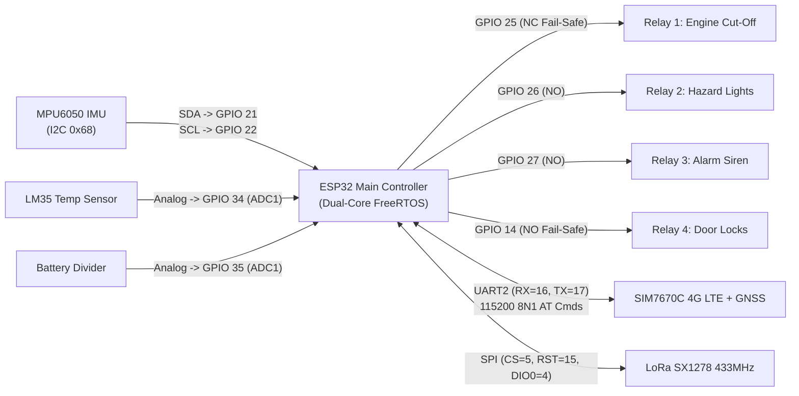

# Telemetry & Anomaly Reconstruction Engine (`TARE // MX-PRO`)


Edge-side automotive crash black-box, multi-signal anomaly detector, and fail-safe relay controller written in **pure C11** (zero `malloc`, zero external libraries), featuring a **100% Hardware-Free Desktop Virtual Lab (`TARE // MX-PRO` Differential Analytics Suite)** and a **Dual-Core FreeRTOS ESP32 Firmware** port.

> **Quick Links:** [1-Page Demo Script](DEMO_SCRIPT.md) · [ESP32 Hardware & Wiring Guide](esp32_firmware/HARDWARE_SETUP.md) · [Contributing & Test Guide](CONTRIBUTING.md) · [MIT License](LICENSE)

---

## Run Without Hardware (One-Command Quickstart)

The entire project runs on any macOS, Linux, or Windows laptop with **only `gcc` and `make`** installed—no ESP32, MPU6050, LM35, relays, SIM7670C, or LoRa hardware required.

```bash
make demo      # or: ./run_demo.sh
```

This single command compiles the engine with the `sim` Hardware Abstraction Layer (HAL), performs boot-time IMU calibration, starts the embedded **SSE + Mock Cloud Server** on **[http://127.0.0.1:8080/](http://127.0.0.1:8080/)** (automatically falling back to `8081..8090` if `8080` is busy), opens your browser to the **`TARE // MX-PRO` Precision Telemetry & Differential (`Δ`) Analytics Dashboard**, and launches a deterministic multi-scenario story (`--auto-demo --seed 42`).

See **[DEMO_SCRIPT.md](DEMO_SCRIPT.md)** for a 1-page presenter walkthrough of what to click and what the audience sees.

```bash
make test        # Run all 7 unit, CSV replay, state-machine, security & benchmark suites
make sync-esp32  # Sync the pure C11 core into esp32_firmware/main_car_controller/
```

### Virtual-to-Physical Hardware Mapping

Every physical component on the car has a live virtual counterpart on the dashboard:

| Subsystem | Physical Hardware (`esp32` HAL) | Hardware-Free Virtual Component (`sim` HAL & Dashboard) |
|---|---|---|
| **6-Axis IMU (250 Hz)** | MPU6050 over 400 kHz I2C (`SDA=21, SCL=22`) | 250 Hz physics sub-stepper with synthetic bias + boot calibration + live waveform |
| **Engine Temperature** | LM35 analog sensor on `ADC1_CH6` (`GPIO 34`) | Thermal model (`80–125 °C`) with hysteresis gauge (`110 °C` enter / `102 °C` exit) |
| **Wheel Speed & Battery** | Hall wheel encoder + voltage divider (`GPIO 35`) | Kinematic speed integrator (`km/h`) + discharge model |
| **4 Automotive Relays** | `GPIO 25` (NC Engine Cut), `26` (Lights), `27` (Siren), `14` (Lock) | Animated LED relay indicators, speed-interlock badge, and black-box actuation log |
| **4G LTE + GNSS Modem** | SIM7670C on `UART2` (`RX=16, TX=17`) via AT commands | Virtual AT responder (`AT+CGATT`, `AT+CGNSSINFO`, `AT+HTTPACTION`), RSSI, and GPS map |
| **Emergency Fallback Radio** | LoRa SX1278 433 MHz over SPI (`CS=5, RST=15, DIO0=4`) | Virtual LoRa SOS broadcaster (`LORA_SOS\|...`) triggered automatically on 4G drop |
| **Non-Volatile Storage** | ESP32 Flash `LittleFS` (`/data/outbox.txt`) | Batched disk persistence (`data/outbox.txt`, `data/timeline.txt`) with wear counter |
| **Operator Override** | Physical keypad / RFID reader | On-screen PIN keypad (`1234`) + HMAC-SHA256 Signed Cloud Command console |

---

## System Architecture

The core engine (`src/circular_queue.c`, `src/linked_list.c`, `src/detector.c`, `src/state_machine.c`, `src/security.c`, `src/modem_at.c`, `src/publisher.c`) contains **zero hardware `#ifdef`s** and **zero dynamic memory allocation (`malloc`/`free`)**. All platform I/O passes through `src/hal.h`.



---

## ESP32 Hardware Wiring Diagram



### Hardware Assumptions & Pinout Notes
1. **ADC1 Selection (`GPIO 34` / `GPIO 35`):** The LM35 and battery voltage divider are wired to **ADC1** (`GPIO 34`, `GPIO 35`) rather than ADC2, because ESP32's ADC2 hardware is disabled whenever Wi-Fi or radio peripherals are active.
2. **MPU6050 Dynamic Range (`±8g` / `±500 °/s`):** Rather than the default `±2g` scale (which clips at $19.6\text{ m/s}^2$ and cannot measure a $2.5g$ crash), `hal_esp32.h` configures register `0x1C` to `±8g` and `0x19` sample divider to `250 Hz` over `400 kHz` Fast I2C.
3. **Engine Relay Fail-Safe Wiring (`GPIO 25`):** Wired through the **Normally Closed (NC)** contact so that if the ESP32 loses power, browns out, or resets via watchdog (`LOW`), the engine remains connected and never stalls a moving vehicle on a microcontroller reset.
4. **Door Lock Fail-Safe (`GPIO 14`):** Defaults to `LOW` (unlocked) on boot/reset and explicitly unlocks on `CONFIRMED` crash so occupants are never trapped inside after a collision.

---

## Real Measured Benchmarks & Detector Evaluation

Measured by `./build/test_benchmark` (100,000 iterations, compiled with `gcc -O2 -std=c11`):

| Operation | Data Structure | Time Complexity | Measured Latency | CPU Cycles / Counter |
|---|---|---|---|---|
| `cq_enqueue` | Static Circular Queue (`storage[256]`) | $\mathcal{O}(1)$ | **8.71 ns** | ~8 |
| `detector_process` | 16-Sample Sliding Window + Multi-Signal Tree | $\mathcal{O}(1)$ | **422.89 ns** | ~422 |
| `cq_snapshot` ($k=128$) | Chronological Ring Unroll | $\mathcal{O}(k)$ | **341.30 ns** | — |
| `ll_insert_by_severity` + `remove` | Static Node Pool (`pool[64]` Free-List) | $\mathcal{O}(n)$ / $\mathcal{O}(1)$ alloc | **6.54 ns** | — |
| `sec_sign_alert` | Pure C11 HMAC-SHA256 | $\mathcal{O}(1)$ | **1,995.30 ns** | — |

> **Real-Time Margin:** At `250 Hz`, the sensing interval is $4,000,000\text{ ns}$ ($4\text{ ms}$). The combined hot-path (`cq_enqueue` + `detector_process` = **$431.60\text{ ns}$**) consumes **0.011%** of the frame budget.

### 250 Hz CSV Replay Confusion Matrix (`./build/test_replay`)

Evaluated across 35 synthetic 250 Hz traces (7 scenario classes $\times$ 5 variants each):

```text
  === DETECTOR CONFUSION MATRIX (Rows=Actual, Cols=Predicted) ===
  Actual \ Pred | NONE   BRAKE  CRASH  ROLL   HEAT   THEFT
  --------------+-----------------------------------------
  NONE          |   10      0      0      0      0      0  
  HARD_BRAKE    |    0      5      0      0      0      0  
  COLLISION     |    0      0      5      0      0      0  
  ROLLOVER      |    0      0      0      5      0      0  
  OVERHEAT      |    0      0      0      0      5      0  
  THEFT         |    0      0      0      0      0      5  
  ---------------------------------------------------------------
  TP=25  TN=10  FP=0  FN=0  |  Precision=1.000  Recall=1.000  F1=1.000
```

---

## Safety, Security & Engineering Tradeoffs

1. **Safe Relay State Machine (`NORMAL -> SUSPECTED -> CONFIRMED -> LOCKDOWN`):**
   * **Why:** Immediately cutting a vehicle's engine upon an accelerometer spike is hazardous if the vehicle is still moving at highway speed (disabling power steering and brake boosters) or if triggered by a false positive.
   * **Solution:** `SUSPECTED` activates only the Siren and Hazard Lights for a $3.0\text{ s}$ confirmation window (cancellable via PIN `1234` or RFID). Upon `CONFIRMED`, the engine cut-off relay is **interlocked with vehicle speed** and only engages once speed $\le 3.0\text{ km/h}$.
2. **Static Pool Allocation vs. `malloc`:**
   * **Tradeoff:** Pre-allocating `TelemetryPacket storage[256]` and `LinkedListNode pool[64]` reserves ~18 KB of static BSS/RAM at compile time instead of allocating on demand.
   * **Benefit:** Eliminates heap fragmentation, out-of-memory faults during a crash, and `malloc` lock contention between FreeRTOS cores, while reducing node allocation/deallocation to a 2-instruction $\mathcal{O}(1)$ pointer swap on `free_head`.
3. **Batched LittleFS Persistence:**
   * **Tradeoff:** Instead of calling `fopen`/`fwrite` on every retry mutation, outbox changes set a `dirty` flag in RAM and flush to flash at most once every `2.0 s` (and immediately on clean shutdown).
   * **Benefit:** Reduces NOR flash erase/write cycles by $>10\times$ during burst alerts while keeping durability bounded.
4. **Cryptographic Command Authentication (No Bare Unlock):**
   * Every remote command (`DISARM`, `LOCKDOWN`, `ARM`) requires a per-device **HMAC-SHA256** signature covering `device_id | cmd | pin | timestamp | nonce`.
   * Commands with $>30\text{ s}$ clock drift or a previously used 64-bit `nonce` (tracked in a 32-entry circular replay cache) are rejected in constant time. Bare `UNLOCK` requests are unconditionally blocked.

---

## CLI Options & Keyboard Controls

```bash
./build/engine --auto-demo --seed 42
./build/engine --scenario collision --at 8 --port 8080
./build/engine --scenario rollover --at 5 --disconnect
```

| Key | Action |
|---|---|
| `c` | Inject Collision (fused accel spike + speed drop) |
| `b` | Inject Hard Brake (with hysteresis) |
| `r` | Inject Rollover (sustained $\ge 60\text{ ms}$ tilt rate) |
| `o` | Inject Engine Overheating ($>110\text{ }^\circ\text{C}$) |
| `p` | Inject Pothole (single-spike road noise — filtered out) |
| `t` | Arm Anti-Theft & Inject Unauthorized Motion |
| `g` | Simulate GNSS Fix Loss |
| `f` | Simulate IMU Rail Saturation / Sensor Fault |
| `u` | Operator PIN Override (`1234`) — cancels alarm / resets to `NORMAL` |
| `n` | Toggle 4G Network Up / Down (demonstrates outbox backoff + LoRa SOS) |
| `q` | Quit cleanly (flushes batched outbox to disk) |

---

## License

This project is licensed under the MIT License — see [LICENSE](LICENSE) for details.
